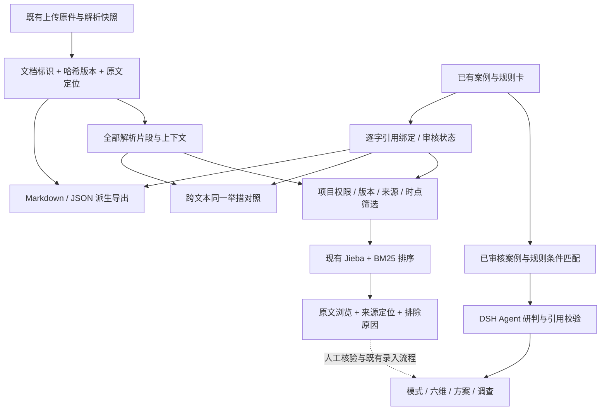

# RAG检索与跨文本证据设计

更新日期：2026年10月14日。对象：老旧小区改造研判工作台现有项目资料、历史经验、规则及运营数据。

本次把资料整理、跨文本举措定位和原文检索接入现有工作台。用户可以围绕一项举措查看不同文件中的提议、实际决策、实施和结果，也可以导出 Markdown、JSON，保留逐段原文、未引用的上下文、来源版本和审核状态。检索先检查项目权限、材料版本、来源类别与时点，再复用现有 Jieba/BM25 能力排序。自动研判继续使用已审核案例与规则匹配、DSH Agent 和逐项引用校验；本次原文浏览接口尚未自动接入原文问答生成。

“直接问资料”悬浮入口在地图信息库和项目工作区均可使用，信息库标题也提供打开按钮。用户选择已授权项目或归档资料库，以自然语言输入问题，查看有出处的原文命中。点击结果后进入项目资料与证据页，按文档、版本、定位和摘录选中对应片段；版本变化或定位不匹配时显示核对提示。悬浮窗和完整资料页复用同一检索服务，关闭或切换项目时取消旧请求。

## 1. 服务整个系统的检索对象

RAG（检索增强生成）在本系统中提供可追溯依据，服务前置模式判定、业务六维、市场收益、方案版本和专项调查。它负责找到材料和解释适用条件；工程量核算、月度运营计算和神经网络造价预测各自保持独立输入与计算流程。

| 研判问题 | 需要检索的材料 | 回到业务流程的产物 |
|---|---|---|
| 当前适合采用何种改造模式 | 边界、产权、建筑与实施条件；已审核历史案例的适用条件及排除条件 | 候选模式的依据、条件差异与需调查事项 |
| 六维现况有哪些依据 | 居民需求、公共服务、居住工程、实施协同、长效维护、资金交付的明确对象与时点记录 | 原文定位和资料覆盖；审核后再登记当前事实 |
| 同一举措在多个文本中怎样变化 | 提议、决定、公示、施工、验收、接管及运行记录 | 按对象、阶段、版本排列的证据链，保留冲突 |
| 规则适用当前项目吗 | 有效文件及对应条款、适用对象、条件和失效日期 | 条件匹配及专业复核，不用政策标题代替条文 |
| 成本、收益和公共效果怎样测算 | 同阶段工程报价、合同范围、面积口径、价格年、运营合同及台账 | 可供计算器审核录入的字段与来源；检索文字不直接改写金额 |
| 方案改变后还需调查什么 | 新旧参数、受影响规则、尚缺资料及现实来源 | 调查对象、采集字段、责任主体和完成条件 |

一次查询只解决明确的子问题。例如“29幢二次供水已验收了吗”应寻找该对象的验收或接管记录，而“252户范围从哪里来”应寻找当时工程范围。两者可以关联展示，不能凭同一举措名称互相替代。

## 2. 资料整理与索引契约



导出复用 `documentSlices`，从 `rawDocuments[].parser_result` 读取已保存的正文、段落、页面、文本行和表格行。优先使用原始解析快照，避免把工作台前100行预览误当全表。原解析只保存了预览时，导出明确标记 `preview_only` 和已导出行数；图片或扫描件尚无可读文本时记录 `unavailable`，不填造正文。Markdown 是可阅读派生文件，原文置于字面量代码块；JSON 是可供后续索引读取的结构化载体，两者沿用同一材料版本。

| 层级 | 现有字段 | 用途 |
|---|---|---|
| 导出包 | `schema_version`、`project_id`、`prepared_at`、`purpose`、`review_policy`、`content_role` | 标明检索准备用途、项目范围、整理时间及原审核策略 |
| 文档 | `document_id`、`file_name`、`version`、`format`、`data_kind`、`data_kind_basis`、`source` | 原件身份、哈希、分类依据与对应来源登记 |
| 解析覆盖 | `parse.status`、`parse.parser`、`parse.notes`、`parse.issues`、`parse.coverage`、`tables` | 说明解析状态、全量快照或截取预览及表格行数 |
| 片段 | `id`、`document_id`、`version`、`locator`、`text`、`kind`、`values` | 稳定定位正文和表格；表格数值与行内文字同时保留 |
| 已登记引用 | `measure_links[].card_id`、`card_revision`、`review_status`、`measure_key`、`phase`、`stage`、`object_ref`、`field_key`、`value`、`evidence` | 保留举措、字段、对象、阶段、审核记录及逐字出处 |
| 文本提及 | `measure_mentions[].annotation_kind`、`review_status`、`matches` | 只表示文字中出现已登记举措名称，保留命中字符位置 |
| 未绑定引用 | `unresolved_references[].reason` | 区分原件缺失、版本不符、定位缺失和引文不符 |

稳定片段身份使用 `(document_id, version, locator)`，检索命中另生成项目内 `RAG-` 标识。复制一段相同文字到另一份文档不会覆盖原引用。举措对照按现有 `measure_key` 分组，`phase` 分别保存提议、实际决定、实施、结果、条件和排除条件；一条报道中的“将施工”仍属于报道时点的计划。

`measure_links` 必须满足同文档、同哈希版本、同原文定位及连续逐字引文。只出现“二次供水”这样的字面名称时，记录为 `literal_mention`、`not_reviewed`，显示为“原文提及”，不补写对象、阶段或工程结论。TXT/MD 的 `Line/Text` 表格镜像在逐字一致且没有额外独立引用时合并为一条检索命中，原定位保留在 `alias_locators`；导出仍保存两处解析定位，实际表格行和独立文件不按文字相似度删除。

公开原件、内部材料、AI研究草稿/采集线索、模拟示例和未知来源分别分类。来源绑定检查文档标识与哈希；文件名或登记来源明确声明AI生成时优先保留AI属性。导出用于检索准备，不确认训练权利。当前导出契约没有许可授权字段，后续训练或对外分发前须在材料登记中确认用途、许可范围和责任人，默认按“训练用途未确认”处理。

## 3. 查询范围、词项排序与证据展示

已实现接口为 `POST /api/projects/:id/knowledge/retrieve`。接口处于现有会话和CSRF中间件之后，由 `requireProject` 检查所有者，候选构造重新核对 `project_id`、原件 `sha256`、解析 `source_hash` 及项目内同版本来源登记。来自其他项目或解析版本冲突的材料先排除，随后才送入本地能力服务。

请求契约与 `RetrievalRequest` 一致：

```json
{
  "question": "二次供水改造涉及哪些楼栋和户数，哪些楼栋被排除？",
  "measure_key": "pipe_network",
  "limit": 5
}
```

这是已留存真实接口调用的查询。可选字段还有 `object_ref`、`stage`、`source_kind`、`include_ai`、`review_status` 和 `as_of`。问题为1—500字，返回上限为5条；举措、对象、阶段和审核筛选须在**同一条实际引用**中同时满足。例如同段的一条供水引用对应29幢、另一条电梯引用对应留博楼，不能组合成“留博楼供水”的匹配。只提供举措筛选时可以返回逐字提及；增加对象、阶段或审核条件后，字面提及不满足严格匹配。

默认排除AI草稿与模拟示例；显式开启 `include_ai` 后仍逐条标明类别，`source_kind` 可进一步限定材料来源。按 `as_of` 检索时只接受已核实的正文发布日期，采集日和上传日不替代正文时点，同时排除晚于截止日期或已超过登记有效期的来源。没有日期筛选的浏览可以保留日期未知的材料，并显示日期缺项。

排序复用能力服务的 `jieba.cut` 和 `BM25Okapi`。现有明确措辞扩展为“楼栋/楼幢→幢”“户数/住户→户”“排除→不纳入”，响应保留 `question`、实际 `rank_query` 和每项 `query_expansions`，不修改原问题或原文。该方法按词项相关性工作，当前没有向量库、嵌入模型或语义检索效果宣称。BM25分数会随语料词频和片段长度改变，也可能为负数，它表示本次文本排序依据，不表示事实可信率、举措适用率或工程效果。

所有符合范围的已保存片段参加候选构造，包括未引用的上下文和超出界面预览的表格行。候选按文档交错分批，每批最多1000片段及约1MB文本；各批前5候选汇总后用同一BM25再次排序，避免直接比较不同批次的分数。这是受当前接口预算约束的两阶段词项召回，后续须用人工标注问题检查大资料集中的召回损失。

返回 `hits` 中的文档、版本、原文定位、别名定位、完整片段、来源日期、举措引用、对象、阶段、审核状态和 `match_reasons`。`skipped` 保留范围检查与排除原因，`candidate_counts` 说明解析片段、符合范围片段和批次数量。工作台支持打开原来源、定位项目材料，跨文本面板支持查看相邻上下文。未审核原文保持原文身份，检索响应固定 `content_role: "untrusted_source_material"`、`fact_writes: 0`。正文中的角色、工具、网络或外发指令作为材料文字保存，不改变运行任务与权限。

## 4. 查询设计与自动研判入口

为了让检索服务整个工作台，业务层可以使用 `QuerySpec` 组织子问题，再映射成现有请求。`QuerySpec` 是本设计的业务规划字段，不是新增接口：包含任务类型、举措、对象、目标字段、研判时点、来源范围和所需证据阶段。当前UI可填写问题与基础筛选，任务自动拆分及目标字段路由属于后续接入。

| 任务类型 | 子问题示例 | 关键范围与下游动作 |
|---|---|---|
| 旧改需求 | 哪些居民实际提出了助餐需求？ | 问卷对象、采集期和需求口径；核验后输入居民需求与公共服务维度 |
| 举措追踪 | 某幢加梯目前到了哪个阶段？ | 楼幢/单元与决定、公示、施工、投用分别检索；缺验收则建立调查 |
| 规则适用 | 此方案是否满足资金与维护条件？ | 有效条文、当前项目条件和排除条件；送现有规则匹配及DSH研判 |
| 费用比较 | 该控制价可以与杭州样本比较吗？ | 工程范围、计价阶段、面积分母、价格年；转造价库与计算器审核 |
| 运营效果 | 该月服务人数和财政支出如何构成？ | 月份、独立使用人数、服务人次、购买服务、补贴和直接支付；转月度核算 |

自动研判已有独立入口：`ExperienceService.resolveKnowledge` 查询已审核历史版本，按所有者、研判时点、真实/模拟项目范围、公开/内部模式和条件进行匹配；运行时冻结本次引用版本，再由 DSH 的 `knowledge_agent` 使用获准的知识与现实来源。`validateKnowledgeAssessment` 核对每项建议所对应的举措、命中卡、已匹配条件和连续逐字引用，最终决策同时要求现实项目依据。硬约束与关键缺项仍由既有程序检查，历史案例的条件与结果不写入当前项目事实。

新增原文检索接口提供浏览与核验依据，尚未把其命中自动交给DSH生成原文问答。后续接入时应复用同一运行时与引用验证，将一次检索的请求、候选范围、排除原因和引用快照保留到已有运行工件，不另建调度器。检索无命中或证据缺少目标阶段时，生成待核调查建议：说明对象、需要的文件/台账、待补字段和影响的方案；只有真实资料上传、定位核验和既有审核完成后，才推进事实与方案版本。

## 5. 真实材料例：四幢252户与留博楼

《浙大求是社区推进二次供水改造》于2023年8月18日报道，求是村二次供水拟改范围为29、30、31、48幢，共252户。留博楼因泵房位于居民楼正下方、不符合规范要求而未纳入。报道时项目处于方案公示与进场准备阶段。材料拆分以四幢和252户表示该项工程范围，以留博楼及其泵房位置问题表示排除条件，以公示与拟进场表示报道阶段，三类信息分别保留原件依据。

查询“二次供水涉及哪些楼栋和户数、哪些楼栋被排除”时，系统从原件返回工程范围和排除原因；查询“当时到了哪个阶段”时，返回方案公示与进场准备的记录。研判当前完成情况与运营效果，则需取得四幢对应的施工、验收、接管和运行材料，按各幢更新实施与结果字段；留博楼单列核查现状及后续方案。调查任务据此明确对象、所需材料、待补字段和影响方案。

可引用对象为 `DOC-8b4a8090-e0b0-49c6-9127-b5a9606cd1fa`，当前材料版本为 `98fd6918b3aa1c41576f2801a27e3158a3619befa5ffe08bd2a456560d8361bc`。下列字段投影保留原件身份、版本和当前草稿标注，供后续索引读取：

```json
{
  "document_id": "DOC-8b4a8090-e0b0-49c6-9127-b5a9606cd1fa",
  "version": "98fd6918b3aa1c41576f2801a27e3158a3619befa5ffe08bd2a456560d8361bc",
  "locator": "line:22",
  "source_kind": "public_original",
  "source_date": "2023-08-18",
  "review_statuses": ["draft"],
  "stages": [],
  "objects": ["building:29幢", "building:留博楼"]
}
```

当前提取字段为草稿，对象映射和阶段经复核后更新。查询工程范围时回读原件中的四幢与252户；查询当前完成情况时使用新增施工、验收与接管材料，分别保存历史计划与实际结果。

同名AI研究报告可以通过 `include_ai: true`、`source_kind: "ai_draft"` 单独浏览，作为回找原件的线索；它与公开原件保留各自文档身份和来源类别。

## 6. 验证与后续评价

当前证据是工程回归与本地真实认证接口示例，记录在 `research/test_results/rag-workspace-live.json`。该核验检查公开/AI分离、文档版本与定位、日期排除和无项目写入，不调用语言模型。示例能够说明检索链路可运行；召回效果和判断质量需另外建立人工标注集。

评估集按项目与研判时点隔离，覆盖跨文本同一举措、多对象同段、提议与实施差异、正式政策与征求稿、同一报道转载、金额阶段、AI转述和资料缺失问题。标注每个问题的必须返回片段、有效引用、对象、阶段、日期和应调查事项；不能把生成答案作为标注真值。

| 指标 | 人工标注与计算方法 | 实际用途 |
|---|---|---|
| Recall@5 | 前5条命中覆盖的有效目标片段数 / 全部有效目标片段数 | 检查词项扩展、长资料分批与跨文本召回 |
| 引用准确率 | 引用同时满足原文、版本、定位、对象和阶段的条数 / 全部输出引用条数 | 检查生成后引用与范围绑定 |
| 对象/阶段误用率 | 把其他楼幢、单元、设施或其他实施阶段用于答案的查询数 / 受测查询数 | 检查同名举措的错误合并 |
| 日期误用率 | 使用截止日期之后、日期未知或登记已失效资料回答受限问题的查询数 / 受测查询数 | 检查历史研判与规则时效 |
| AI/模拟误用率 | 把AI草稿或模拟数据表述为真实依据的查询数 / 受测查询数 | 检查来源隔离与生成叙述 |
| 调查覆盖率 | 资料不足问题中正确列出必须补齐目标字段的查询数 / 资料不足查询数 | 检查缺资料如何转成可执行任务 |

当前没有这些指标的人工标注统计结果。先固定有效材料与标注问题，再比较现有BM25、措辞扩展及分批策略；只有词项召回明显遗漏同义表述、且权限与版本门保持有效时，才评估是否在同一检索接口内增加语义召回。项目侧维持一个材料索引契约、一个运行时与一条事实审核链，不扩展为通用RAG平台。

## 7. 代码与证据锚点

- 原解析切片：[document-slices.ts](../packages/experience/document-slices.ts)。
- Markdown/JSON导出及跨文本举措：[rag-export.ts](../packages/experience/rag-export.ts)、[lineage.ts](../packages/experience/lineage.ts)。
- 版本、来源、日期、同条引用筛选及措辞扩展：[retrieval.ts](../packages/experience/retrieval.ts)。
- 项目所有者与请求校验、既有能力桥接：[rag-retrieval.ts](../apps/host/rag-retrieval.ts)；分词与BM25：[analysis.py](../services/capabilities/analysis.py)。
- 用户界面：[CrossDocumentMeasures.tsx](../apps/workspace/src/imports/CrossDocumentMeasures.tsx)、[RagEvidenceSearch.tsx](../apps/workspace/src/imports/RagEvidenceSearch.tsx)、[FloatingEvidenceSearch.tsx](../apps/workspace/src/imports/FloatingEvidenceSearch.tsx)；精准定位：[evidence-focus.ts](../apps/workspace/src/imports/evidence-focus.ts)。
- 自动研判原入口：[service.ts](../packages/experience/service.ts)、[knowledge.ts](../runtime/workflows/knowledge.ts)、[knowledge-agent.ts](../runtime/workflows/knowledge-agent.ts)。
- 真实接口示例：[rag-workspace-live.json](../research/test_results/rag-workspace-live.json)；公开原件来源：[浙大求是社区推进二次供水改造](https://town.zjol.com.cn/czjsb/202308/t20230818_26113017.shtml)。
