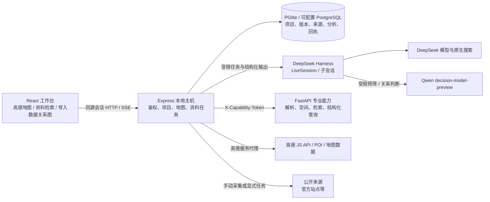

# 建工 AI 技术文档：系统架构、核心算法与接口

从用户提供的《海之子杯_AI原生执行包_v2.zip》实际构建，当前源码包含本地地图工作台、项目研判与公开资料检索。原 ZIP 保持不变；本文件描述**已实现的接口和约束**，运行状态以 `agent/state.json`、`agent/intelligence-state.json` 及相应测试记录为准。真实企业成效和训练效果尚无样本可验收。

## 当前系统架构（2026-10-02）

`apps/workspace/src` 负责地图与检索交互，不保存模型密钥；`apps/host/server.ts` 是本机统一入口和数据库所有者。`packages/contracts/schema.json` 是项目输入的唯一业务契约源，生成 TypeScript/Pydantic 类型；`packages/intelligence` 负责公开资料版本、检索、模型流水线、事件归并和人工复核；`runtime/intelligence/judge.ts` 在已有 DSH 会话内执行模型阶段；`services/capabilities/app.py` 提供受令牌保护的解析、检索和空间计算。高德安全密钥与模型密钥只在本机配置，不进入浏览器或 Git。

部署契约是**单操作员本地工作台**：仅接受配置的 loopback Host/Origin；`GET /api/session` 发放 `HttpOnly`、`SameSite=strict` 会话 cookie；后续 `/api` 与高德代理请求验证 cookie，写请求还验证 `X-Requested-With: haizhizi`。这不是已验收的多租户身份系统。项目、来源和上下文在数据库中按版本保存；公开正文与合成样例分别标注，未核实的地块、面积和收益不由模型补全。

### 导入数据关系图与面板分析

`apps/workspace/src/imports/ImportedDataExplorer.tsx` 在项目“资料与证据”页读取本项目文档列表，`graph-model.ts` 将保存的解析结果投影成只读关系图和节点分析面板。数据链为：上传文件 → 宿主调用现有 ParserPort 并将 `parser_result` 写入 `documents`，同时在项目输入中保存同 ID 的 `Source` 和来源绑定的 `table_row` 记录 → 工作台读取项目输入、`GET /api/projects/:id/documents` 与当前展示的决策包来源 → 浏览器内归一化、连线和统计。切换项目或项目 `context_version` 变化时重新读取文档列表；视图本身不写回事实，也不调用模型。

图以项目为根；上传文档以文档 ID 关联同 ID 的项目来源，向下展示解析表或文本行、字段与原文定位；含表的 Word 文档仍保留正文段落节点。切换到“全部来源”时，另外展示项目输入和当前决策包中的来源；同 ID 合并时项目输入优先于已完成研判的来源快照。非 `table_row` 的 Fact 仅凭显式 `source_id` 连向匹配的文档或来源，`public_records` 也须保留相同的 `source_id`。边只表示项目归属、解析结构和明确的来源引用；同名、同值、相近地点都不产生推断关系。未找到来源的 Fact 可计入总数，但不伪造图边。旧研判快照可能落后于当前项目版本，不能因为在“全部来源”中可见就视为当前已核事实。

| 面板指标 | 计算口径与解释 |
|---|---|
| 导入文件、关联来源、格式、待 OCR 文件 | 分别计本项目 `documents` 返回条数、按 ID 合并后的项目/研判 `Source` 条数、文件名扩展名分布，以及解析状态为 `ocr_required` 的文档数；来源数不等于上传文件数。 |
| 解析表、文本行、解析行数、字段数、已截取预览表 | 对归一化后的 `parser_result.profile.tables` 求和；TXT/MD 的 Line/Text 结构计为“文本行”而非解析表，空白文本解析为 `empty`，不产生表或行。解析行数取各结构的 `rowCount`，字段数取 `columnCount`，截取由 `truncated` 或 `rowCount` 大于可见行数判断。这是解析器处理范围内的数字，Excel 等格式存在读取上限，不能当作原文件总量。 |
| 可见预览行、来源绑定原始行、其他结构化事实 | 前者计各表实际保留的 `rows`，图模型每表最多读取 250 行；后两者分别计当前项目输入中 `kind=table_row` 和其余 Fact。每次上传最多保存 1000 条 `table_row`；原始行是带来源的解析记录，并非已核业务事实，Fact 数量与文件全量行数、预览行数不要求相等。 |
| 字段完整度与常见值 | 优先显示解析器提供的 `fillRate`、`missingCount`，无字段画像时按可见预览行估算；截取表的解析器填充率按预览估计并标为 `estimated`。去重值与最多 5 个常见值来自预览，面板中的频数不是全表频数；行预览与解析器画像均缺失时显示未知。 |

“总览 / 结构 / 字段”控制展开层级，“导入文件 / 全部来源”控制来源范围，搜索只筛文件或来源的名称与 ID；窄屏提供文件/来源节点的快速定位。无上传文件时自动显示已有项目来源。选中节点后，右侧面板按类型展示文件状态、解析器、指纹与问题，表格行列和字段完整度，原文定位，或来源类别、可见性与明确引用。图形收起的表和正文段落仍可从文件面板打开；原文定位支持筛选与分批展开。归一化每文档最多取 50 表、1000 个原文段，每表最多取 100 字段和 250 行预览；图最多显示 16 张来源卡片（字段模式为 8 张），每个子层再有节点上限。表格面板最多呈现前 8 行、前 5 列。顶部统计在搜索和图节点截取前计算，但已受解析器与归一化上限影响；界面没有全量原始行浏览或分页。`GET /documents` 目前返回完整的保存解析结果，单文件上限为 10 MB；多份大文本的初次传输和浏览器归一化仍有容量风险。无法提取正文的扫描 PDF 标记待 OCR，不以空文本生成字段或肯定事实。解析文本、字段类型和列统计帮助检查材料结构与质量，不能证明权属、工程安全、法规效力或投资可行性。该 GET 路由受同源本机会话和项目存在性检查保护，返回含解析文本和行预览的保存结果而非原文件字节；内部材料不能当公开数据，且此路由不构成多租户访问控制。

### 等待界面与状态边界

`components/WaitingScene.tsx` 用本项目绘制的 SVG 与 CSS 呈现“勘察游标”：定位光点沿抽象街区移动，环形标记缓慢转动；当真实研究 `stage` 变化时，资料页只翻动一次。首次项目读取显示全屏加载页；会话和项目就绪后，高德连接改用地图中央的同一游标，地图尚不可用时暂时收起禁用的地图控件；地图连接失败仍按原有超时、错误和重试路径处理。项目研判摘要、地图对象研究和导入资料读取使用紧凑版动效，停止按钮、已有证据与运行记录保持可访问。

状态文字立即挂载；装饰图形与全屏遮罩延迟 250 毫秒出现，短请求不闪整屏。文字由当前项目请求状态或实际 SSE/NDJSON 事件驱动，装饰动画不表示百分比、预计完成时间或已经取得的证据；地图标色继续使用真实 `completed/total` 进度。`prefers-reduced-motion` 下保留静态图形与状态文字，动画图形对读屏隐藏。此实现没有引入外部动效依赖、Telegram 源码或品牌素材。

### 核心算法与边界

当前新增业务方向为老旧小区综合整治提升，面向开发建设企业投资拓展与前期策划。`MapScreenProfile=neighborhood` 与 `ProjectInput.business_profile=neighborhood` 贯通地图检索、DSH、Qwen 与项目研究；新六维口径为居民需求、公共服务、居住工程、实施协同、长效维护、资金交付，版本 `neighborhood-renovation-fit-v1`。旧 `opportunity-fit-v2` 保存结果按原标签展示。六维是业务观察，非政府评分标准；人口/服务背景和对象自身工程事实保留不同空间范围，既有证据准入门没有放宽。

`packages/retrofit/planning.ts` 独立输出“建议进一步尽调／先补充关键资料再判断／当前条件下暂缓”。只读取标记为 `epistemic_status=fact`、有来源版本/定位、观察时点有效且明确绑定本项目的确认记录；估算、方案假设与缺失不进入门槛。七项前置确认包含居民需求、工程评审、服务缺口、范围与协同、资金、维护及专业规则。明确安全、权属或保护否决条件优先。该门在离线与真实模型最终发布前写入 `DecisionPacket.neighborhood_action`、建设路径和导出报告，雷达等级不能抵消否决条件。正式专业确认仍须来自企业与专业人员，模型不替代鉴定。

基础／完善／提升三类工程预算、预备费、计划资金和户数的调整由程序算静态总额、假设资金缺口与户均工程投入。面板全部输入明确为方案假设；未填写保持未知，不自动成为确认事实，也不改变行动门。目前方案比较是浏览器中的本次比较，未实现正式企业成本库或持久化方案审批。

历史经验使用同一 PGlite/PostgreSQL 新增 `experience_cards` 和不可覆盖的 `experience_history`，复用已有文档解析、DSH 和全文检索。十字段区分决策问题、背景、条件、备选、提议、实际决策、决策依据、实施、结果、适用边界；非空值须有当前项目原文的逐字引用、定位和文件哈希。默认本地仅提取明确标签，未识别的叙述不猜成历史事实；显式模型提取须符合既有内部资料外发许可。草稿人工复核后才进入跨项目检索，修改后重新变成草稿；类型、模式、阶段、目标资料时点、owner 与合成类别共同过滤。复用绑定经验版本和项目版本，仅生成 `heuristic/unverified` 调查线索，不能自动生成当前硬约束。当前没有获准企业历史样本或业务效果评价，公开翠苑一区资料是历史流程验证案例，详见 `老旧小区改造_产品与验证方案.md`。

经验接口：`GET /api/projects/:id/experiences`、`POST /api/projects/:id/experiences/extract`、`POST /api/projects/:id/experiences`、`POST /api/projects/:id/experiences/:cardId/update`、`POST /api/projects/:id/experiences/:cardId/review`、`GET /api/experiences/search`、`POST /api/projects/:id/experiences/reuse`。提取用 `document_ids/use_model`；更新与审核用 `expected_revision`；复用用 `expected_card_revision/expected_version`。检索不能将目标项目时点向未来扩展，复用再次核验版本记录时点。所有接口沿用本机会话、CSRF 和项目权限，不另建身份系统。

| 模块 | 当前做法 | 结果约束 |
|---|---|---|
| 地图选区与坐标 | 点选先给浮卡；拖框至少 8 像素，单次范围经纬宽高各不超过 0.06 度。高德显示坐标为 GCJ-02，选区交由 Python 空间能力转换/校验为 WGS84 Polygon。 | 用户框选是调查范围，不冒充法定宗地边界；合成位置不叠加真实片区。 |
| 地图初筛与标色 | 从 POI、建筑/道路/水系、已有项目来源构成快照；按实施条件、空间适配、使用需求、供给、运营组织、资源安排六维和主题规则出可解释颜色。显式点击后才运行进一步分析。 | 颜色是初筛线索，不是收益预测或批准；来源不足时显示未知与资料缺口。 |
| 公开资料采集 | `rss`、`web_list`、`json_list`、`native_search`、`external` 通道均做域名白名单、URL/长度校验；默认关闭定时采集与自动模型分析。来源 URL、内容哈希、观测时间和版本分别保存。 | 重复观测不制造新版本；站点结构变化显示失败/部分成功，不能记为零条成功。 |
| 检索与时点 | `Intl.Segmenter` 中文分词加长词二元字，标题权重 A、正文权重 D 写入 PostgreSQL `tsvector`；SQL 用 `ts_rank_cd` 召回，再按词面匹配、日期和稳定 ID 排序。`as_of` 按历史观测版本查询。项目研究入口另复用 Python 既有 BM25 检索。 | 网页资料搜索是词法检索，不声称向量语义搜索；返回 `truncated`，避免把有限候选误当全量。 |
| 模型判断 | 有正文才进入预筛 `PASS/BLOCK/UNKNOWN`；Qwen 路由可承担预筛及关系判断，DeepSeek DSH 子会话做结构化提取和两次独立 0–100 阅读价值评分。阈值默认 65，即两分和至少 130；分歧大于 20 或预筛 `UNKNOWN` 转人工复核。 | 分数代表“值得继续阅读”，不是投资回报率；阈值未通过人工标注集校准，不以此自动批准项目。 |
| 原文绑定与事件 | 模型结构化 JSON 先通过 DSH 可表达 schema，再由本地完整 JSON Schema 和原文核对。`locator_quote` 必须逐字出现在标题或正文；项目编号必须在引文内，城市不在引文内时清空。候选事件先做词面有界召回，再核对象编号、发生日期、动作和关系判断；招标与中标是后续阶段。 | 虚构引文/身份进入 `needs_review` 且不评分；同主题不能自动当同一次事件。 |
| 调用回执 | 回执键由阶段、对象版本、输入和模型规范化哈希组成，状态为 `started/completed/ambiguous`。每日本地调用上限可配置。 | 已完成阶段可复用；中断或结果不确定的付费调用不自动重试。 |
| 人工评价与语料 | 人工 review 绑定文档内容版本、来源家族、reviewer、用途和时点；检索/选择/聚类评价与导出分开，`development/holdout/train` 的同源家族不得交叉。 | `local_sft` 需要显式许可与训练 split；目前无经批准训练样本，未开始权重训练。 |

当前原文校验验证的是**字面存在和引文内包含**，还不能证明字段的业务角色：同一引文里的“杭州市”可能是采购代理机构地址，并非项目位置；正文出现的日期也可能是提交截止而非公告发生日期。在补上角色对应和原文记录定位前，模型城市与 `occurred_at` 不应单独作为地图定位、当前可参与状态或事件时间线的证据。现有地域筛选和事件归并仍可能受这些误标影响，必须保留人工核查入口。

`packages/decision/brief-view.ts` 对已经冻结的决策包做只读聚合：把实施/建筑、需求/组织、企业/资源六项判断归并为三组，结合专业发现、路径动作、独有前提与可回溯来源呈现。现有结果可直接重排，不额外调用模型；保存的原始判断不被覆盖。网页“需要先成立”优先显示本路径独有条件，导出报告列出完整调查发现、引用、差异化路径与下一步。没有实际来源时不生成肯定结论。

机制参考库保留原50例，并新增10个截至2026-09-29核对的跨领域案例：城市更新合作、零碳工业园区、绿色算力设施、社区养老托育、轨道TOD与都市工业、低空基础设施、排水防涝、历史街区、公共建筑节能、城中村改造。每例区分公开事实、分析、迁移条件、来源及公告状态；运行时仅按选定项目名称匹配最多三个，不从整份抓取正文的偶然关键词借用其他领域案例；没有匹配就不附案例，也不把其他项目的金额、受益人或仍有效的申报/投标窗口移植过来。完整出处见 `runtime/skills/investment-brief/references/README.md`。

### HTTP 接口说明

下表为 `apps/host/server.ts`、`apps/host/map-screening.ts` 和 `apps/host/intelligence.ts` 的现行路由。响应均为 JSON，标记“流”的路由按 SSE 或 NDJSON 返回；写接口须携带上述会话及请求标识。参数表列出关键字段，完整字段以路由的 Zod 校验和 `packages/contracts/schema.json` 为准。

| 方法与路径 | 主要输入 | 主要输出/行为 |
|---|---|---|
| `GET /health`；`GET /api/session`；`GET /api/ready` | 无 | 宿主活性；本地会话与配置；数据库、Python 能力是否就绪。`configured` 不代表实时调用已成功。 |
| `GET /api/projects`；`POST /api/projects`；`GET /api/projects/:id` | `input` 或限定 fixture、`name`；项目 ID | 项目列表、新建项目（201）、项目及运行列表。 |
| `POST /api/projects/:id/runs`；`GET /api/runs/:id` | `mode`、`execution_mode`、`idempotency_key`；运行 ID | 冻结输入并异步运行（202）；查询状态。重复幂等键不重复发布。 |
| `GET /api/runs/:id/events`（SSE）；`GET /api/runs/:id/trace` | 运行 ID、事件游标 | 进度重放、模型调用追踪。 |
| `POST /api/runs/:id/cancel`；`POST /api/runs/:id/resume` | 运行 ID | 请求取消或按保存的会话/阶段恢复。 |
| `GET /api/runs/:id/decision-packet`；`GET /api/runs/:id/report` | 已完成运行 ID | 结构化决策包或 Markdown 报告；未完成时返回冲突。 |
| `POST /api/projects/:id/context-proposals`；`/context-updates`；`/context-revoke` | 提议、版本及变更 | 编译、版本锁更新或撤销组织上下文。 |
| `POST /api/projects/:id/documents` | 单文件表单上传；TXT/MD/CSV/PDF/DOCX/XLSX，最多 10 MB | 按项目和 SHA-256 去重；新文件解析入库后保存同 ID 来源及来源绑定原始行，项目上下文版本递增。重复文件直接返回既有记录。 |
| `GET /api/projects/:id/documents` | 项目 ID；当前不读取分页或筛选参数 | 校验项目后按 `project_id` 返回 `{id,file_name,parser_result,created_at}[]`，供关系图读取解析表、行预览、原文定位和状态；不返回原始文件字节，也未承诺列表排序。 |
| `POST/GET /api/projects/:id/followups` | 调查项或项目 ID | 保存或读取后续核查任务。 |
| `GET /api/maps/data`；`GET /api/maps/screening/profiles` | 无 | 数据目录、初筛画像及主题配置。 |
| `POST /api/maps/geometry/wgs84` | `{geometry}` | 拓扑校验并返回 WGS84 Geometry。 |
| `POST /api/maps/screening/context` | `{target}` | 有来源的选区快照 `context_id`；需要高德配置。 |
| `POST /api/maps/screening/analysis`；`GET /api/maps/screening/analysis/:id` | `context_id`、`profile`；分析 ID | 按快照研判（可 NDJSON 流式）或读取已保存分析。 |
| `POST /api/maps/screening/scan`（NDJSON） | `bounds`、`profile`、`theme`、可选 `geometry` | 有界逐区扫描和标色进度；单次仅允许一个活动扫描。 |
| `GET /api/intelligence/status`；`GET /api/intelligence/search` | 查询 `q/city/category/as_of/limit/offset` | 通道、任务、预算状态；按事件分组的来源摘要、数量与截断状态。 |
| `POST /api/intelligence/channels`；`POST /api/intelligence/channels/:id/collect` | 通道配置；`{model:boolean}` | 保存默认禁用的通道；显式排队采集任务（202）。 |
| `POST /api/intelligence/sync`；`POST /api/intelligence/intake` | 游标；公开 `source` 和可选通道 ID | 将既有公开项目来源同步入库；录入来源及内容版本。 |
| `GET /api/intelligence/items/:id`；`POST /api/intelligence/items/:id/analyze` | 可选 `version`；分析需 64 位版本哈希 | 版本、引文、来源、分析；显式排队模型分析（202）。 |
| `POST /api/intelligence/jobs/:id/cancel`；`GET /api/intelligence/projects` | 任务 ID | 请求取消；可关联的非合成项目及当前输入哈希。 |
| `POST /api/intelligence/items/:id/attach` | `version`、`project_id`、`expected_input_hash` | 乐观锁将真实公开来源加入项目，不自动生成 Fact/Rule。 |
| `POST /api/intelligence/events/link`；`POST /api/intelligence/reviews` | 两个文档版本与关系；人工标签、家族、split、用途 | 人工关系绑定；保存与具体内容版本关联的人工复核。 |
| `GET /api/intelligence/evaluation`；`POST /api/intelligence/dataset/export` | `split`；`purpose=local_eval/local_sft` | 评价指标或受权限/家族切分约束的数据集导出。 |

Python 内部服务由宿主调用，`POST /parsers/parse` 接收受控文件路径/文档 ID；`POST /capabilities/{name}` 支持 `analyze`、`spatial.profile`、`retrieval.query`、`structured.query`、`research.gaps`；`POST /spatial/validate-geometry`、`/spatial/selected-geometry`、`/spatial/regions` 处理空间几何。除 `/health` 外均须 `X-Capability-Token`；浏览器不直接调用这些内部接口。

示例：本地网页先 `GET /api/intelligence/search?q=浙江大学&limit=20`，从 `items[].representative` 读取标题/来源/时间；点击条目再 `GET /api/intelligence/items/:id?version=...`，只有用户明确请求分析才 `POST /api/intelligence/items/:id/analyze`。分析异步返回任务 ID，任务状态由 `/api/intelligence/status` 查看；`needs_review` 是条目的 `analysis.status`。地图交互同样先选中显示线索，再显式触发研判。

### 构建、测试与实际数据范围

从仓库根目录运行 `bash scripts/start.sh` 启动本机工作台，`npm run verify` 检查契约生成、JavaScript/Python、HTTP 回归和生产构建。模型、高德和抓取配置来自本地忽略的 `.env` 与 `data/local`，不要写入仓库。DSH 依赖在本次升级为官方 [`0.2.0-rc.1`](https://github.com/deepseek-ai/deepseek-harness/releases/tag/dsh-v0.2.0-rc.1)；本地完整 schema 约束保留在 DSH 可表达子集之外验证。

2026-09-29 的实际资料联调从中国政府采购网手动采集 8 份浙江大学相关公开原文入本机 PGlite，网页搜索、详情和原始链接已在真实浏览器读回；这些本机数据不随 Git 提交。DSH 升级合并后，对其中一份公告显式运行完整本机流水线：Qwen 预筛 `PASS`、DeepSeek 归类为招采、两次阅读优先级为 78/82，任务完成且网页详情显示“招采 · 已分类”；引文未支持的城市保留为空。它们包括已过投标截止日期的历史公告，因此页面展示应明确阶段与有效期，不能解读为仍在报名的商机。完整证据见 `research/test_results/dsh-rc1-intelligence.json`；公开资料样本不是企业项目效果验证。

## v0.2 基线实现与验收记录

以下保留早期实现节点的验证口径；当前资料检索、DSH 版本和接口以文首的现行说明及状态文件为准。

### 实际调用链

React 工作台 → TypeScript 宿主（项目、权限、版本、SSE）→ DeepSeek Harness（真实模型、受限专业任务、候选、反证、比较）→ 统一 Python 能力与公开研究入口 → PostgreSQL 业务记录和 DSH 执行记录 → 可追溯决策包。

真实模式挂载官方 DeepSeek provider，使用实际原生搜索响应和匿名原文获取；记录 requested/returned model、调用时长、token 和 session_id。格式错误可有界重试，但不替换成 fixture 响应。离线适配器是明确标注的独立工程测试模式。

三个专业角色分别研究建筑/实施、需求/运营、案例/企业适配。它们没有 shell、任意文件读取、自由外发或继续委派工具。候选、反证和比较使用相互隔离的 DSH 子会话；相同模型的角色分工不等于独立专家共识，也不采用投票。

### 验证过的业务行为

- 真实初筛与真实企业增强可以生成结构化发现、动作、反证、比较矩阵和调查清单。
- “不整体拆除”是经项目配置人提出的组织约束；“最好分期”是偏好。不能因前者不是法规而降成不生效线索，也不能把后者升成外部强制规定。
- 局部拆改不会被误判成整体拆除。模型不能用路径名称掩盖 `whole_demolition` 动作。
- 引用必须闭合于获准快照。已存在 Fact/Rule 的引用可以解析到其来源；捏造引用被拒绝。比较器只能引用实际生成的候选，不能从更大的候选池另添路径。
- 缺结构、权属、建筑面积或需求时保留未知。模型填写的数值不能覆盖工具计算的指标；不同建筑记录不跨对象拼接。
- 组织条件更新按输入依赖局部重评；旧快照、旧报告和已完成工件保留。JSONB 键重排不改变规范化内容哈希。
- 重复请求不重复发布；SSE 支持游标重放；Context 更新有乐观版本锁；失败后可从原快照恢复 DSH 父会话并读取已完成阶段工件。

### 数据、权限与来源

应用的唯一业务契约源为 `packages/contracts/schema.json`，生成 TypeScript/Pydantic。原包 `contracts/task-envelope.schema.json` 是保留的设计示意，不是 DSH 原生配置，未形成第二套消息调度系统。

来源和事实保留 data_class、visibility、引用、对象/时间/单位及 unknown。检索在权限过滤之后执行。模型只取得该项目和该角色需要的快照；真实内部正文默认不出本机，需明确配置获准端点才能启用内部模型分析。项目原话配置与正式工程/投资批准分开。

TXT/MD/CSV 走 CRE 通用解析；PDF/Excel 使用 CRE 选择性移植的提取与表格定位，DOCX 通过同一 ParserPort 注册 python-docx。扫描 PDF 明确返回 `ocr_required`。表格行作为来源绑定记录保存，不直接编造成已核实项目总量。

公开研究使用两轮有界查询、政府域名来源和 DSH 安全 HTTP 获取；原文被截断、被拒绝或缺失会保留状态。RegionPack 不声明全国一致覆盖；同名地名不自动选择，不将地点坐标当宗地边界。当前地名服务为非商业研究配置，署名 GeoNames / Open-Meteo。

### 复用事实

| 上游 | 实际迁移/调用 | 范围 |
|---|---|---|
| CRE / Apache-2.0 | 工作台结构、通用 CSV/文本、PDF 页文本、Excel 行定位、报告表格 | 选择性复用；未启用收购控制器和固定结论 |
| DeepSeek Harness / MIT | AgentLoop、Subagent、结构化输出、JSONL、恢复、模型/搜索/HTTP/代理入口 | 唯一业务 AI 运行时 |
| HIRE / MIT | cursor → columns/rows 接口；参数化、只读、作用域及执行预算 | 冻结快照中的结构化查询 |
| RETQA / MIT | 槽位函数与企业标签修正 | 已提供城市字段/显式槽位的转换；不冒称完整 RETQA |
| GeoAgent / MIT | 元数据类和访问函数 | GIS 工具元信息；计算由 Shapely/pyproj 完成 |
| STORM / MIT | URL/片段归并 | 权限过滤后的检索归并，不把重复来源当多份证据 |
| Search-o1 / MIT | 标记提取与有界文档摘要模板 | 接统一研究与检索入口，未复制其本地推理服务 |

精确 ref/blob/target/hash/修改/测试在 `research/upstream.lock.json`。CityBench、PlanBench、LLM-Geo、BacktestBench 是有数据或需求后才采用的条件候选，本次没有为挂名而复制。

### 实测与恢复

实测覆盖契约、源函数、字段缺失/冲突、候选顺序、约束语义、权限过滤、SQL 只读/预算、文档格式、幂等、SSE、重启恢复及浏览器流程。真实模型测试还覆盖冻结结果交接、字段引用闭合、候选范围限制、原生 API 错误与从失败节点恢复。

真实杭州案例保留 5 条检索来源：4 篇正文、1 条元数据。未提供真实建筑清单，所以总面积、空置面积和比例仍未知。实际原文和返回模型都可从日志、快照和引用核查，不能解读成完成真实项目勘察或企业效果评测。

提示注入实测使用独立合成内部标记。该标记未进入 DSH 模型输入；逐子会话核查只授予对应分析工具及 `structured_output`。这是一个实际攻击样例和结构性权限边界的证据，不是对所有提示注入的无限保证。

默认存储是已经实测的 PGlite 嵌入式 PostgreSQL。外部 PostgreSQL/PostGIS/pgvector、生产多租户身份系统、企业私有端点与真实企业样本需在相应部署条件下另行验收；本次没有偷偷替换成“已通过”。

### 语料准备

`packages/corpus/schema.ts` 定义采集、人工标注和用途凭证的本地结构；业务 `Source` 继续校验主 Canonical Schema。`scripts/corpus.ts` 可以重建语料、从已完成本机运行归集公开来源、导入显式来源包、查询原文、导出经核对样本。HTML 解析和 BM25 检索复用已有公共实现，没有新增搜索服务或训练调度器。

正文按稳定来源哈希保存，分块保留 Unicode 字符位置；同 URL、同项目家族、规范化重复和字符近重复在划分前归组。原模型会话与回归 gold 不进入语料正文，既有开发来源不伪装成最终测试集。监督样本必须具有当前内容版本对应的人工标签、原文引用及本地训练用途凭证；错误时使当前导出指针失效，旧版本保留。生成文件、标注与用途记录都留在 `data/local/corpus`。

第一批来源目录、待标注入口和质检见 `data/local/corpus/语料台账.md`；操作和后续案例收集重点见 `data/corpus/README.md`。新增测试针对源内容篡改、同源泄漏、旧标签、缺少用途记录、引用伪造、凭据和回归数据隔离，不把结构校验误称为标签正确性或行业模型效果。

### 地图入口与地点选择

主界面以高德 JS API 2.0 地图为中心。官方 loader 管理 SDK 加载，原生图层显示道路、楼块、景观与地点标注；本应用只叠加自己的卫星图层，不用 `setLayers()` 重建高德内部图层。地图选中只打开简要浮卡，明确点击后才取 POI 完整详情或逆地理编码；项目研究面板继续复用原有研判功能，关闭面板保持地图视角。

Canonical Schema 增加可选 `Scope.map_anchor`，明确记录高德 GCJ-02 点位；`Scope.geometry` 仍是 WGS84，显示时通过高德官方 `convertFrom` 转换，不手写坐标偏移或把点位扩成研究边界。合成项目的虚构坐标不会叠加到现实城市。

地图设置和 `/_AMapService` 共享本地会话、Host/Origin 与写入保护。服务端固定上游高德域名、限定服务路径、覆盖客户端 key/jscode，并限制超时和响应长度。JSAPI 请求保留 `s=rsv3`、`platform=JS` 等原生参数；经校验的 JSONP 回调显式使用 JavaScript MIME，保持 `nosniff`。安全密钥不返回浏览器，原生 JS Key 按官方 SDK 方式使用。

Windows 挂载盘上的 Vite 开启有界文件轮询，避免 Windows 编辑后 WSL 未收到通知而继续服务旧代码。相关实测单独记录在 `research/test_results/map.json`，不把 Linux 软件显卡的 2D 降级记作 3D 成功。

### 申报口径

可写：“已形成可运行工作台，接通真实模型、原生检索、受限专业任务、候选/反证/比较、企业经验版本化与局部重评，并完成相应工程和样例测试。”

不能写：“已完成全国数据覆盖”“已验证企业投资效果提升”“能够自动签发结构安全或投资批准”“多个同模型角色形成独立专家共识”。正式业务验证仍需获准企业案例和专家复核，后续结果不能倒灌到当时输入。

### 2026-09-28 地图初筛与真实项目证据

首次选中现在直接汇集四类高德记录，并按坐标/城市关联当前项目与已完成研究的公开来源；城市背景不转成地块事实，合成项目不参与真实片区统计。用户显式触发初判后，复用 DSH LiveSession 对同一快照形成引用可查的分析。内部事实、原文、规则与项目名不会进入公共快照转交路径。

新增五个单指标标色专题、固定图例、九格进度和取消、范围变更提示及数据目录。接口、来源精度、缓存、完整性阈值、交互参考和实测时间见 `docs/地图初筛与数据关联.md`。当前校验入口是 `research/test_results/screening.json`，旧版地图记录只代表其对应版本。

GitHub 新建为私有 `zhu607705-coder/jiangong-ai`；项目数据库、内部材料、密钥、DSH 会话与原始浏览器日志留在本机。源码保留用于复现的公开快照和显式合成回归工件。HTTP 回归使用当前 Node 进程路径，干净克隆不要求包含本机 `.tools` 目录。
