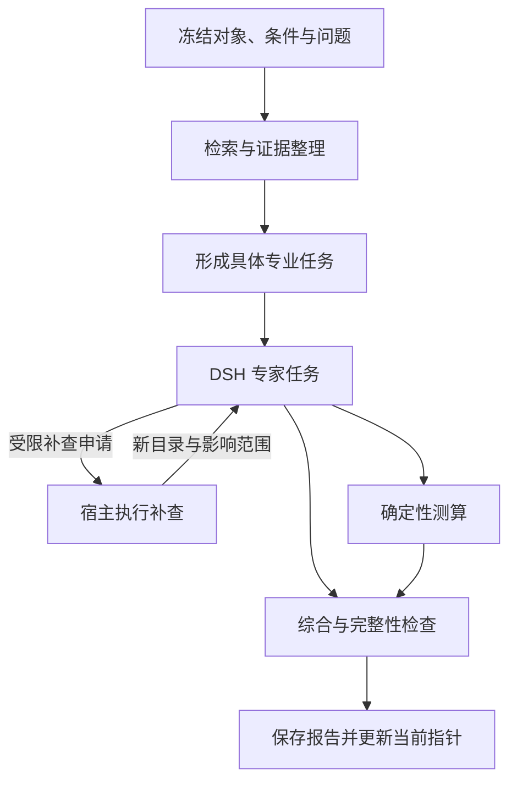

# 评审结论

**建议继续以现有 DSH、Store、原文解析和能力接口为基础演进。先统一对象、有效版本和业务节点回执，再修复证据覆盖与补查流程，最后扩大 Decision 的替代范围。DeepSeek 新 Search／Fetch 值得接入对照，但它的收益需要与这些流程修复分别测量。**

现有混合检索、原文引用检查、专家权限隔离、局部重试和研究轮次记录，都应保留为共同基础。它们已经解决了一部分问题；下一步需要让这些能力之间遵守一致的数据合同。

本评审以你提供的 `29f5ef08d8c520c09752278574732b53cc28a485` 核查记录为代码事实基线。外部接口与参考架构已核验一手资料；没有访问项目源码、修改生产代码或执行线上实验。下文的接口、表结构和验收条件均为**实施建议**。

---

## 一、问题清单：先区分确定缺陷、现场观察与待验证假设

这里的 P0 指优先修复会污染判断的基础问题；它不要求暂停条件方案交付。

| 优先级 | 问题与证据状态 | 根因判断 | 最小修正 |
|---|---|---|---|
| **P0** | 登记天津对象，研究内容包含杭州、上海材料：已确认 | 对象身份尚未成为来源片段、专家结论和报告的共同约束；具体失守环节待逐点核对 | 固定对象版本，给证据和结论增加对象关系，限制异地事实进入本对象事实字段 |
| **P0** | Decision 曾只读独立缓存；该入口已修正 | 多种业务状态并存，消费者可能自行解释“当前”；其他入口是否仍重复选择待核查 | 单一 `resolveCurrentContext()`，区分当前研究结果和已发布版本 |
| **P1** | HTTP 断连中止、重启将 running 标失败、中间成果集中随最终结果保存：已确认 | HTTP 生命周期、DSH 会话与业务执行状态没有充分分离 | 在现有 workflow 上增加节点回执，独立恢复已完成阶段 |
| **P1** | 缓存达到 10 份时，新抓取预算归零：确定的分支缺陷 | 历史复用、新发现和最终上下文共用同一来源数量预算 | 三种预算分开，保留总时间与成本上限 |
| **P1** | 机电公告已命中，组合回答未完整呈现相关字段：一次现场观察 | 可能发生在证据选择、上下文打包或答案生成；现有证据不能唯一定位 | 建立逐子问题覆盖合同，并记录各阶段的证据去向 |
| **P1** | 共用 Decision 客户端允许 24 题，项目入口限制 16 题 | 能力限制散落在业务入口 | 在共用能力边界统一类型、题数、用量、错误与版本 |
| **P1** | 内部资料导致整个分析包被省略：已确认 | 派生结果缺少足够细的依赖与授权视图 | 从获准事实重建用途视图；旧混合包继续保守处理 |
| **P1** | 全库 CI 存在失败：已确认 | 新接口、旧 mock 和运行环境之间的集成合同有缺口 | 修共享 API 合同和测试环境适配，重新跑完整作业 |
| **P2，但应立即埋点** | 校准、资源分配、压缩语义保持缺少独立实验 | 目前主要采用工程启发式 | 先建立可复现评价，再决定扩大自动化程度 |

需要避免三种过度推断：

- 一次非供水查询成功，证明该路径具备相应能力；不能推出总体回答完整率。
- 8 个归档问题的 `source-hit@5=7/8`，不能替代答案质量、金额阶段正确性或 Decision 评价。
- 未做校准，不代表 Decision 必然不准确；目前能成立的结论是**正确性、校准和领域适用性尚未独立验证**。

---

## 二、最小架构：在现有 DSH／Store 上统一四份合同

建议统一：

1. **对象与条件合同**：这轮研究针对谁、哪个范围、什么条件。
2. **证据合同**：这条结论来自哪份表示、支持哪个问题、与对象是什么关系。
3. **执行合同**：哪个节点完成了、可复用什么、失败后从哪里继续。
4. **输出合同**：每个问题怎样得到交代，六页怎样读取同一有效结果。

### 2.1 对象约束要落实到证据片段和结论

只给整篇来源贴“天津资料”标签不够。一篇文章可能介绍多个城市；同一社区也可能有不同标段、年份和工程范围。

建议在既有对象、来源和分析结构上增加以下字段：

```ts
type ContextRef = {
  projectId: string;
  objectRevision: number;
  conditionsRevision: number;
  objectiveRevision: number;
  manifestVersionId: string;
  authorizedViewHash: string;
};

type EvidenceBinding = {
  sourceVersionId: string;
  representationVersionId: string;
  locator: ExistingLocator;
  quoteHash: string;

  objectRevision: number;
  scopeId?: string;
  relation:
    | "same_object"
    | "subarea"
    | "comparable_case"
    | "general_rule"
    | "different_object"
    | "unresolved";

  bindingBasis:
    | "verified_identifier"
    | "reviewed_evidence"
    | "model_candidate";
};
```

执行规则应明确：

- 规范标识、行政区、地址或地图范围出现明确冲突时，相关片段不能支撑本对象事实。
- 名称相同、语义相关、来源权威，都不能覆盖这一冲突。
- `same_object` 还需要核对工程范围和时间。同社区另一个标段的成交价不能替代当前标段成本。
- 外地案例可以保留为 `comparable_case`，同时记录迁移假设。
- 当前天津登记保持原状，新增对象核对问题；旧报告保留原内容与历史版本。

对象尚待核实，也可以继续输出条件研究。此时限制的是“事实归属”，而不是“是否允许研究”。

### 2.2 “当前有效”不能简单等同于“最后完成”

最后完成的轮次可能启动于旧条件，也可能在更新轮次之后才返回。

建议六页和所有能力入口统一调用：

```ts
resolveCurrentContext(projectId, principal): Promise<{
  context: ContextRef;
  activeAnalysisVersionId?: string;
  publishedReportVersionId?: string;
  currentRoundId?: string;
  freshness: "current" | "stale" | "unresolved";
  staleReasons: string[];
}>;
```

其规则是：

1. 读取明确的当前结果指针。
2. 核对对象、条件、目标版本及授权。
3. 迁移期指针为空时，统一寻找最近的**适用**结果。
4. 发布缓存按明确的报告版本读取。
5. 已发布版本与当前研究版本分别展示。

**资料缺项不影响条件报告成为当前结果。** 适用性检查针对对象、版本、授权和结构合同。

报告提交采用 CAS：提交时检查启动时捕获的条件版本和结果代次。旧轮次晚返回，可以进入历史，不能覆盖新的当前结果。对于同一条件下的并发研究，还需保存请求序号，避免仅按完成时间争夺当前指针。

### 2.3 执行结构



这张图表示现有研究 workflow 的职责边界，不要求增加一个独立调度系统。

| 节点 | 输入 | 立即持久化的输出 | 恢复单位 |
|---|---|---|---|
| `freeze_round` | 对象、条件、用户问题、授权材料 | 输入快照、问题清单、初始 manifest、配置版本 | 本轮快照 |
| `acquire_evidence` | 未覆盖问题、缓存、搜索预算 | 每次调用回执、成功来源版本、覆盖状态 | 单次获取与单个来源 |
| `plan_tasks` | 具体问题、证据覆盖、剩余预算 | 0–3 个任务、负责的问题、来源目录、预期产物 | 完整任务计划 |
| `expert:<taskId>` | 任务及冻结目录 | 结构化结论、实际读取窗口、引文、缺项、补查申请 | 单个专家任务 |
| `supplement:<batchId>` | 合并后的补查申请 | 执行决定、新来源、新 manifest、受影响问题 | 单批补查 |
| `compute:<scenarioId>` | 明确范围和情景参数 | 费用、现金流、服务效果及输入依赖 | 单个情景 |
| `synthesize` | 可用专家成果、测算、未解决问题 | 条件报告、声明依赖、逐问题状态 | 综合产物 |
| `validate_commit` | 报告、当前版本、实时授权 | 校验回执、报告版本、当前指针 | 短事务 |

`taskId` 应对应具体任务。角色仍可沿用建筑实施、投入价值、居民运营，但任务需要明确写出负责哪些 `questionId`。固定角色问题不能替代本轮问题规划。

### 2.4 表结构：优先扩展原表，只新增窄回执表

以下是逻辑结构，编码时应映射既有 Store 字段，避免重复保存同一业务事实。

| 存储位置 | 建议字段 | 关键约束 |
|---|---|---|
| 现有项目记录 | 对象版本、条件版本、目标版本、当前分析指针、发布版本指针 | 当前选择只有一个权威入口 |
| 现有 `research_rounds` | 输入快照、启动条件版本、请求序号、manifest、workflow 版本、取消代次 | 输入快照不可被后续编辑覆盖 |
| 新增 `research_node_receipts` | `round_id, node_key, input_hash, status, attempt, fencing_token, lease_until, output_ref, error_code` | `UNIQUE(round_id,node_key,input_hash)` |
| 新增或扩展调用回执表 | `operation_id, attempt_id, provider, request_hash, outcome, response_ref, usage, billing_state` | 每次外部尝试单独记录 |
| 现有来源与解析记录 | 来源版本、表示版本、hash、解析器版本、获取时间 | 引文绑定不可变表示 |
| 现有轮次 JSON／关联记录 | manifest 版本、问题覆盖、声明依赖 | manifest 追加新版本，历史不改写 |

Store 只需增加少量原子方法：

```ts
claimNode(nodeKey, inputHash, lease): Promise<NodeLease>;
commitNode(lease, output): Promise<CommitResult>;
appendManifest(parentId, approvedEntries): Promise<ManifestVersion>;
resolveCurrentContext(projectId, principal): Promise<CurrentContext>;
commitReport(expectedContext, report): Promise<"activated" | "historical">;
```

大正文、专家结果和报告继续使用现有 Store 的产物机制。

### 2.5 恢复：业务结果不重复生效，外部调用如实记账

每个节点采用三段式：

1. **短事务领取**：记录输入 hash、租约、递增的 `fencing_token`。
2. **事务外执行**：调用 DSH、Python 或网络能力。
3. **短事务提交**：检查 token、输入版本和取消代次，再接受结果。

旧 attempt 的迟到响应可以进入调用记录，但不能覆盖新 attempt 的节点输出。

本地唯一键和 CAS 能保证结果不重复生效。它们不能保证供应商只执行或只收费一次。请求已发出但回执丢失，应记录 `unknown_outcome`；如果供应商没有查询或幂等能力，恢复时重新请求可能再次计费。

LangGraph 可以借鉴的正是这一层机制：checkpointer 保存执行状态，Store 保存跨执行业务数据；并行阶段中成功节点的写入可保留，恢复时无需重跑成功节点。[Docs by LangChain](https://docs.langchain.com/oss/javascript/langgraph/checkpointers?utm_source=chatgpt.com)

PGlite 官方明确为单连接实例，并提供事务。因此当前方案应保持**单一数据库 owner**，网络任务并发，数据库写入集中且短暂；同时核实实际持久化配置。不能据此假设多个宿主可同时打开同一数据目录。[PGlite](https://pglite.dev/docs/multi-tab-worker?utm_source=chatgpt.com)

HTTP 建议调整为：

- 启动接口持久化任务后返回 `202 + roundId`。
- SSE／轮询负责订阅进度。
- 连接关闭只解除订阅。
- 用户显式取消才更新取消状态并尝试 abort。
- 重启后检查未完成节点，复用成功回执，恢复其余阶段。

同时分开三个状态：

```ts
runStatus        // queued / running / completed / failed / cancelled
evidenceStatus   // sufficient / partial / none / conflicting
reportStatus     // unavailable / conditional / ready
```

个别专家失败、资料缺失或 Decision 不可用，均可以对应“执行完成＋条件报告”。综合模型也失败时，宿主仍应能用已有结构化成果形成最小条件报告。

### 2.6 授权视图：最终引文不能代表完整依赖

这里最需要防止的错误是：删掉内部引用后，把受内部材料影响的总结、排序或数值继续发给 Decision。

建议规则：

- 确定性变换可记录到字段级依赖。
- 生成产物默认继承该节点实际输入的权限，包括 prompt 和工具返回内容。
- 模型自报的引用列表，不能证明它没有使用其他输入。
- 发给 Decision 的视图，从该用途获准的事实重新构造。
- 旧混合分析包缺少 lineage 时，维持当前省略策略，另用获准事实重新生成相应用途视图。
- 内部材料继续用于本地确定性计算，以及已经获准接收它们的 DSH 路径。

权限判断至少包含：**用户能否读取、目标 provider 能否接收、结果能否导出**。实际读取还应取“冻结 manifest 范围与当前权限”的交集，避免历史快照绕过权限撤销。搜索 query 和调用日志同样需要遵守这份合同。

---

## 三、检索与报告：把“命中来源”推进到“逐项回答”

### 3.1 给组合问题建立可检查的交付合同

本次现场问题可以拆成九个基本格子：

| 分项 | 金额 | 金额阶段 | 资金来源 |
|---|---|---|---|
| 机电配套 | 对应金额记录 | 预算／成交／结算等 | 对应资金证据 |
| 雨棚 | 可同时存在多个金额 | 各金额分别标阶段 | 对应资金证据 |
| 消防通道 | 对应金额记录 | 对应阶段 | 对应资金证据 |

每个格子必须有明确状态：

```ts
type AnswerSlot = {
  questionId: string;
  status:
    | "supported"
    | "conditional"
    | "missing"
    | "conflicting"
    | "not_applicable";
  claimIds: string[];
  assumptionIds: string[];
  followUpTaskIds: string[];
};
```

由此分开两个指标：

- **交付完整性**：每个格子是否都有交代。
- **证据回答覆盖率**：其中多少格子由适用原文正确支持。

`missing` 可以满足交付完整性，不能计为证据支持。

同一雨棚的预算和成交价应作为两条记录保留。若用户问结算，而资料只有成交，系统应说明已知成交、结算待查，不能用最新出现的金额覆盖所有阶段。

金额建议使用结构化记录：

```ts
type MoneyObservation = {
  objectRevision: number;
  scopeId: string;
  amountDecimal: string | null;
  currency: string;
  unit: "yuan" | "wan_yuan" | "yi_yuan" | "other";
  stage:
    | "estimate" | "budget" | "control_price"
    | "award" | "contract" | "settlement"
    | "payment" | "unknown";
  priceYear: number | null;
  inclusions: string[];
  fundingSource: string | null;
  fundingStatus: "planned" | "approved" | "received" | "unknown";
  evidence: EvidenceBinding[];
};
```

金额阶段、资金来源、到账状态要分别取证。

### 3.2 先定位漏失阶段，再选择检索改造

建议给每个必答格子记录：

`原文存在 → 已解析 → 进入候选 → 被选中 → 进入最终上下文 → 被正确回答`

| 漏失位置 | 优先处理 | 对 embedding 的判断 |
|---|---|---|
| 原文有内容，解析结果没有 | 表格、附件、OCR、分段与定位 | 无法解决解析丢失 |
| 解析结果有内容，未进入前 60 个候选 | 子问题召回、领域同义词、候选席位、可选稠密召回 | 适合做独立增量对照 |
| 已进入候选，后续判读过滤掉 | 重排标准和候选判读 | 先修判读 |
| 已进最终上下文，主回答遗漏 | `AnswerSlot` 合同和综合提示 | 优先修输出覆盖 |
| 引用充分但对象或标段错误 | 对象、范围和时间绑定 | 相关性提高仍可能出错 |

现有词项召回、语义摘要、LLM 判读和融合继续保留。第一步应给每个子问题保留候选席位，再做合并排序，防止一个高频主题占满全部窗口。

### 3.3 专家补查必须成为宿主执行的动作

专家提交受限申请：

```ts
type InvestigationRequest = {
  taskId: string;
  questionIds: string[];
  missingFields: string[];
  suggestedQueries: string[];
  domainHints: string[];
  affectedDecisions: string[];
};
```

宿主合并申请、核对权限和预算后执行。补查结果生成新 manifest，并记录：

- 新增或更新了哪些事实；
- 与哪些旧结论冲突；
- 哪些任务需要增量重跑；
- 哪些结论仍可复用。

仅保留原来的 `evidenceRefs` 依赖还不够：**新证据可能推翻先前“未发现问题”的判断**。因此任务还需要关联 `questionIds`、对象范围和时间范围，才能识别尚未被旧结论引用的新反证。

“打开搜索引擎链接”和“执行补查”应作为两个明确动作。自动补查在已有授权、配额内进行；没有必要每个专家申请都让用户确认。

### 3.4 压缩应检查关键事实保持

建议把压缩包分成：

- **关键事实记录**：对象、金额、阶段、单位、前提、否定、冲突双方。
- **解释摘要**：推理、比较、候选措施。
- **原文定位**：实际表示版本与引文窗口。

至少分别测量：

1. 去重后的实际证据输入；
2. 压缩产物；
3. 最终实际发送给模型的完整上下文，包括系统提示、schema、摘要和重复引文。

如果第三项比未压缩方案更长，应先检查重复装入和封装开销。压缩有损时应保留未解决项和原文访问能力，不能用“窗口仍在”代替语义保持证明。

---

## 四、Decision：统一能力边界，按依赖就绪情况批处理

官方当前明确规定单请求最多 16 题、`state` 最多 65,536 tokens。`score` 是从 0 开始的等级编号的概率期望；官方没有给出 `confidence` 的业务校准保证。其示例中 `confidence` 与所选类别概率也不同。[Alibaba Cloud Documentation Center](https://www.alibabacloud.com/help/en/model-studio/decision-model-api?utm_source=chatgpt.com)

### 4.1 三类能力怎样分工

| 判断 | 主责 | Decision 的适用位置 |
|---|---|---|
| 对象 ID、明确行政冲突、版本与权限 | 确定性程序＋必要的人工核对 | 提供模糊实体匹配候选 |
| 子问题拆解、专业任务内容、条件措施 | DSH | 选择已有候选任务的路由和 effort |
| 缓存配额、截止时间、重试和计费 | 确定性程序 | 通常不需要 |
| 哪些请求字段仍未回答 | 结构化覆盖合同 | 筛查语义上含糊的覆盖情况 |
| 候选来源与问题的相关性 | 现有召回与重排 | 批量比较少量候选或获取方案 |
| 哪些调查值得先做 | 情景敏感性＋DSH 调查卡 | 对受控候选做快速优先级判断 |
| 引文是否存在、单位与算术是否一致 | 确定性程序 | 不替代这些检查 |
| 原文是否支持否定、前提、金额阶段 | 原文核验＋生成模型／人工评审 | 筛出疑点，不能作为最终事实证明 |
| 正式实施条件、资金到账、居民决议 | 有效证据字段＋适用规则＋授权人员确认 | 不得用分数覆盖 |
| 报告字段齐全、引文无悬空 | 确定性程序 | 不宜替代 |

确定性程序也只能依据已经建立的规则和经确认的事实执行，不能仅凭字段齐全就认定专业鉴定或正式决议成立。

### 4.2 统一客户端应负责什么

在现有 `decision-model.ts` 集中实现：

- 问题数 `1…16`，题型与 criteria 校验；
- 相同上下文、授权视图、rubric 和目标版本的请求组批；
- 返回 ID、类型、有限数值和概率合法性校验；
- `score` 与返回 `legend`、分布期望的一致性；
- 原始答案、合法答案、无效项、用量与错误分别保存；
- 根据完整输入版本缓存；
- 400 合同错误不原样重试；临时错误有界退避；
- 部分答案无效时保留其余答案；
- Decision 不可用时采用既有 DSH 和明确的规则回退，标注排序来源。

缓存键至少覆盖：

`模型配置＋对象/条件/目标版本＋manifest＋授权视图＋状态内容＋问题集合＋rubric版本`

### 4.3 ≤16 的批处理方案

| 就绪阶段 | 可合并内容 | 数量示例 |
|---|---|---:|
| 地图初筛 | 六维条件暂估、下一步、少量缺项优先级 | `6 + 1 + ≤9` |
| 初轮证据与任务形成后 | 专家 effort、调查候选优先级 | `≤3 + ≤13` |
| 当前方案形成后 | 六页下一步、措施与资料优先级 | `6 + ≤10` |

这些是**可用批次**，不是要求每轮固定调用三次。没有新状态就复用回执；规则已经能决定的步骤可以直接完成。

最终若同时需要“六维＋六页＋十项排序”，共 22 个判断，就必须明确分批。输入独立时可用 `16+6` 并行；后一批依赖前一批结果时保持顺序。不能把多项独立判断塞进一个 `instructions` 来规避题数限制，也不能复用旧 manifest 上的六维结果充当新结果。

### 4.4 六维暂估与参考分的科学边界

五级编号为 `0…4` 时：

- 显示为 `1…5`：期望值加 1。
- 显示为 `0…100`：期望值乘 25。

这是显示约定。序数等级之间未必等距，不能据此解释为金额、效用或成功率。

**零证据还有一个隐蔽问题：均匀的五级分布同样会得到 3 级期望。** 因此不能只依靠“没有硬填中分”来避免伪精确。

建议六维分别保存：

```ts
{
  empiricalAssessment: null,
  conditionalAssessment: {
    assumptions: [...],
    distribution: ...,
    rubricVersion: ...,
    verificationTasks: [...]
  },
  evidenceStatus: "missing"
}
```

条件判断必须针对明确假设形成。缺少合理量化依据时，可以给条件分支和可能等级范围，保持事实值为空。

此外，每个维度应明确 `construct` 和 `direction`。居民需求、公共服务短缺和工程问题偏向“更新必要性”；协同、维护能力和资金条件偏向“实施准备程度”。直接对六维取均值容易混淆方向。

### 4.5 排序与调查价值

当前五项措施、五项资料可以继续作为局部重排，但必须记录：

```ts
{
  eligibleCandidateCount: ...,
  scoredCandidateIds: [...],
  unscoredCandidateIds: [...],
  selectionPolicyVersion: "...",
  orderScope: "scored_subset"
}
```

未入选条目不能自动解释成低价值。评价要同时检查“重要候选是否进入这五项”和“入选后排序是否合理”。

目标权重变化时，已有可比较指标应优先确定性重算。只有需要新的语义判断时才重调模型，否则难以区分合理换序与模型波动。

调查优先级第一版可依据：

- 哪些合理结果会改变候选方案或投入阶段；
- 是否涉及高后果冲突；
- 获取资料需要多少时间和成本；
- 资料能否实际解决该问题。

只有建立了结果概率和可比较效用，才适合计算严格的信息价值。模型熵或 `confidence` 可以作为辅助特征，不能直接当作“预计决策改善”。

---

## 五、DeepSeek Search／Fetch 的适配设计

### 5.1 三条路径独立对照

| 路径 | Search | 正文获取 | 要验证的收益与代价 |
|---|---|---|---|
| A：旧路径 | 模型 `web_search` 回合 | 普通 HTTP＋已有解析 | 当前质量；模型回合延迟和费用 |
| B：独立接口 | Search，关闭 `need_content` | 选择性 Fetch＋既有回退 | 减少搜索模型回合；Markdown 质量与额外抓取延迟 |
| C：混合路径 | Search，开启 `need_content` | 复用可用正文，必要时 Fetch | 减少 Fetch 次数；返回体积和下游 token 增量 |

三条路径均挂在既有 `ctx.web` 下，复用模型配置、凭据管理和调用回执。provider 选择在轮次开始时固定；发生回退时记录实际路径。

### 5.2 请求编译与边界

Search 官方字段包含 `query`、`count`、`ori_question`、`localization` 和 `need_content`；前两种文本字段有 128 字符限制，`count` 为 1–50。`localization` 接收 IP。站点与日期条件需编译进 query，未知 JSON 字段会被忽略。[DeepSeek API Docs](https://api-docs.deepseek.com/zh-cn/api/search/?utm_source=chatgpt.com)

adapter 建议接收应用语义，再映射为 provider 请求：

```ts
type SearchSpec = {
  query: string;
  originalQuestion?: string;
  maxResults: number;
  includeContent?: boolean;
  filters?: {
    sites?: string[];
    excludedSites?: string[];
    after?: string;
    before?: string;
  };
};
```

具体规则：

- 先保留对象名称、城市／区县、项目号和待查字段，再删减重复表述。
- 完整拼接后检查 Unicode 长度，不能只用 JavaScript UTF-16 `length`。
- 超长时拆分查询，避免截断引号、操作符或金额阶段词。
- 原问题超过限制时可省略 `ori_question`，宿主保留完整原问题。
- 地域通过实际对象信息表达，不伪造 `localization`。
- 日期操作符只用于检索；结果仍需核对真实适用时间。

### 5.3 缓存、新发现与上下文分开

建议起步采用以下**实验配置**：

| 预算 | 起点建议 | 含义 |
|---|---:|---|
| 搜索操作 | 6 次 | 保留当前规模，便于比较 |
| 新证据名额 | 4 份 | 与缓存数量无关；可由 Search content 或 Fetch 获得 |
| 旧来源刷新／关键复核 | 2 份 | 用于更新和金额表格复核 |
| 额外重试 | 有限独立额度 | 失败也消耗尝试额度 |
| 最终上下文 | 沿用现有上限起步 | 依据问题覆盖选择，不要求装入所有来源 |

关键验收是：缓存已有 10 份，仍有未覆盖问题和适用新来源时，新证据能够进入。

名额是上限，不要求用完。总请求数、剩余时间和成本继续封顶。Search 已返回并通过核验的正文，不必为消耗名额重复 Fetch。

搜索缓存键应包含 provider、完整编译查询、原问题字段、`count`、`need_content`、时间条件及用途视图。来源快照与搜索结果缓存分开管理，不能靠一个 TTL 同时代表内容新鲜度和证据有效性。

### 5.4 域名分配与重排

首批搜索按未覆盖问题安排：

- 本对象主管单位、所属学校官网及采购网站；
- 对应地区政府、交易和财政来源；
- 与当前问题直接相关的附件；
- 明确标为类比的其他城市案例。

学校归属尚未核实，就先核实归属。固定杭州、上海案例不应占用本对象关键字段的优先预算。

重排采用：

1. 最小化 URL 去重，保留项目号等有意义参数。
2. 对象与工程范围核对。
3. 为各未覆盖问题保留候选。
4. 综合相关性、来源直接性、适用时间和获取成本。
5. 正文到手后再次核验。

provider 的 `authority`、`rerank_score` 只作为排序信号。高权威的异地公告仍不能成为本对象事实。

### 5.5 表示版本与 Fetch 回退

Fetch 的公开响应合同是标题和 Markdown 正文，没有承诺原始字节、源站版本标识或原文坐标。Search content 也不能默认与 Fetch Markdown 完全相同。[DeepSeek API Docs](https://api-docs.deepseek.com/api/fetch?utm_source=chatgpt.com)

建议记录：

```ts
type SourceRepresentation = {
  sourceId: string;
  sourceVersionId: string;
  representationId: string;
  kind: "raw_html" | "pdf" | "deepseek_markdown" | "search_content";
  representationHash: string;
  originBytesHash?: string;
  extractorVersion?: string;
  receivedAt: string;
  reportedPublishedAt?: string;
};
```

引用绑定实际使用的表示：

- Markdown：表示版本＋字符区间＋quote hash。
- PDF：继续使用现有页码／区域定位。
- 原始文件未取得：原件 hash 留空。
- Markdown 重新转换：产生新表示，旧 offset 保留在旧表示上。

金额表格错列、合并单元格丢失、附件未取得时，回退到原有合法读取与解析路径。访问策略拒绝应保留为拒绝状态，不能自动换路径绕过。

### 5.6 限流、重试与费用

官方规定 Search、Fetch 各自按账号限速 5 QPS，Fetch 另有未公开数值的域名限制。两接口均按有结果的成功请求计费，价格为 5 元／千次；一般工作台调用不能默认套用编程工具优惠。[DeepSeek API Docs](https://api-docs.deepseek.com/zh-cn/guides/search?utm_source=chatgpt.com)

实现上：

- 现有宿主维护账号级 Search、Fetch 限流器。
- Fetch 增加域名队列；单域并发 1 可作为保守起点，但不是官方限额。
- 对可恢复错误使用指数退避和随机抖动；存在 `Retry-After` 时遵守。
- 400 修请求；401／402按凭据或账户问题处理；不原样循环。
- 单次网络失败不能解释为资料不存在。

费用回执建议区分：

| 情况 | 记录 |
|---|---|
| 完整收到成功且有结果响应 | `expected_charge` |
| 明确空结果或服务端失败 | `expected_free` |
| 客户端中断、崩溃，结果未知 | `unknown` |
| 已与供应商账单核对 | `reconciled` |

当前费率下，已确认成功调用的预期工具费用为：

`0.005 元 ×（成功 Search 次数＋成功 Fetch 次数）`

模型 token 费用另记。客户端丢失响应不能证明服务端未成功；存在未知调用时，显示已知费用与未知数量，避免制造精确总价。

---

## 六、相近架构：借鉴机制，并明确替换判据

| 参考 | 可借鉴机制 | 在当前工作台的落点 | 需要承担的代价 |
|---|---|---|---|
| Anthropic routing／orchestrator-workers | 按实际问题分工，路由与任务内容分离 | 具体任务绑定 `questionId`，Decision 选 effort，DSH 形成内容 | 规划调用可能增加延迟 |
| Anthropic evaluator-optimizer | 有明确判据的反馈循环 | 修复未回答格子、悬空引文和金额阶段错误 | 缺少判据时容易重复生成 |
| LangGraph persistence | 节点状态、并行成功写入、恢复与业务 Store 分离 | 现有 workflow 的节点回执 | 采用完整框架会引入状态映射、升级和运维成本 |
| Azure agentic retrieval | 多子问题检索、重排、合并、引用和活动记录 | 覆盖矩阵与逐阶段检索记录 | 额外规划和重排延迟 |
| Open Deep Research | supervisor、researcher、compression 的分工 | 补查申请、受控专家与压缩产物 | 通用 research prompt 和异常处理仍需领域适配 |

Anthropic 对动态任务拆分和有明确评价标准的反馈循环给出了对应适用条件。[anthropic.com](https://www.anthropic.com/engineering/building-effective-agents?utm_source=chatgpt.com) Azure 明确保留子查询、重排和活动记录，同时承认相对单查询存在额外延迟。[Microsoft Learn](https://learn.microsoft.com/en-us/azure/search/agentic-retrieval-overview?utm_source=chatgpt.com) Open Deep Research 当前仓库已归档；源码中的压缩会保留摘要和 raw notes，但其压缩机制本身不能保证金额阶段与否定条件完整。[GitHub](https://github.com/langchain-ai/open_deep_research/blob/main/src/open_deep_research/deep_researcher.py?utm_source=chatgpt.com)

### 何时值得更换组件

| 组件 | 启动试验的条件 | 必须测出的收益 |
|---|---|---|
| 增加 embedding | 金标窗口存在，但词项预筛持续漏掉同义表达 | 固定上下文预算下，候选召回提高，并转化为答案覆盖收益 |
| 引入 GraphRAG | 大量问题依赖跨文档多跳关系，现有标识关联和结构化查询仍不足 | 多跳答案正确率提高，且图抽取、更新、权限成本可接受 |
| 增加 Agent | 错误归因显示某类独立问题缺少专业处理 | 同等或明确增加的预算下，质量提升足以承担 P95 成本 |
| 更换持久执行框架 | 节点回执反复无法满足恢复、人工中断或版本升级需求 | 故障恢复正确性、维护成本有可测改善 |
| PGlite 换服务端 PostgreSQL | 确需多宿主并发写、故障接管，或单 owner 写队列持续违反服务目标 | 吞吐、恢复时间和持久性改善，同时通过原有业务合同 |

对于“对象—标段—合同—金额阶段—来源”这类已经可以明确结构化的关系，先做可靠关联。图数据库或 GraphRAG 的试验应由剩余问题推动。

---

## 七、科学性验证：分别测来源、答案、判断和实际效果

### 7.1 评价集按真实对象分组，再做时间隔离

可以先建立一个计划中的启动集，例如 **30 个对象、每对象 4 类任务**，用于调试和试点评价。这个规模是工作量建议，不构成泛化证明。

必须包含：

- 一般住宅、大学社区及来源稀少对象；
- 同名异地对象；
- 同社区不同标段；
- 预算、成交、合同、结算并存；
- HTML 表格与 PDF 附件；
- 缓存饱和；
- 内部与公开材料混合；
- 零命中但仍需条件报告；
- 条件、目标或权限在运行中变化。

划分规则：

- 同一物理对象的别名、材料和轮次属于同组。
- 公告原件、PDF、镜像和转载不能造成跨组重复。
- 开发、校准、测试对象不交叉。
- 现有 8 个归档问题保留为回归集，不再充当独立最终测试。
- 时间回放只能使用当时可获得的内容版本。旧发布日期不能证明当前页面内容在当时已存在。
- 无历史快照时采用前瞻采集，避免伪造时间隔离。
- 模型训练数据时点不可核实的部分单独说明；评价主要约束其依据给定证据回答的能力。

最小样本结构：

```ts
type EvalCase = {
  caseId: string;
  objectGroupId: string;
  asOf: string;
  task: string;
  requiredSlots: Array<{
    slotId: string;
    answerability: "known" | "not_disclosed" | "conflicting" | "unreviewed";
    acceptedValues: unknown[];
    goldEvidenceSpans: EvidenceBinding[];
  }>;
  distractorSourceIds: string[];
  split: "dev" | "calibration" | "test";
  labelStatus: "adjudicated" | "disputed" | "unlabeled";
};
```

关键金额与对象归属采用独立标注、争议裁决。模型可以辅助找证据，但不能用同一个生成结果给自己制作正确标签。

### 7.2 三种对照需要分开

| 实验 | 固定什么 | 改变什么 |
|---|---|---|
| 固定证据实验 | 对象、原文版本、授权、上下文预算 | 召回、重排、压缩、回答合同、Decision |
| provider 实验 | 查询、缓存快照、候选选择、预算、综合模型 | 旧路径／新 Search＋Fetch／content 混合 |
| 全流程实验 | 用户任务、起始条件与授权 | 完整当前实现和改造版 |

同时保留三个系统条件：

- **当前基线**：用于反映产品实际改善。
- **DSH-only**：保留同样的对象、权限和确定性底座，关闭 Decision，用 DSH 承担可比语义任务。
- **改造版**：启用新合同与拟推广能力。

另做必要消融：只修基础合同、增加覆盖驱动补查、替换 provider、扩大 Decision。否则无法归因收益。

### 7.3 必测指标

| 方面 | 指标定义与注意点 |
|---|---|
| 错对象 | 错误归属的目标事实／目标事实；另报发生过错配的报告比例 |
| 来源覆盖 | 已标注必要来源 recall@k；金标窗口在字符／token 预算下的召回 |
| 答案覆盖 | 正确回答的可回答格子比例；缺失格子处理正确率另报 |
| 引用 | 定位成功率、语义支持率、需要证据的声明覆盖率 |
| 金额 | 对象、范围、数值、单位、阶段、价格年、包含项的联合正确率 |
| 压缩 | 关键事实、否定、前提和冲突保持率；最终答案变化 |
| Decision | 分类与序数错误、严重错误、概率质量、分层校准 |
| 排序 | 候选预选召回、可接受 top-k 覆盖、成对排序一致性 |
| 条件变化 | 应改变时的合理变化，无关变化下的稳定性 |
| 恢复 | 已完成节点复用、迟到响应隔离、取消和版本变化处理 |
| 性能与费用 | 分阶段及整轮 P50/P95、失败、重试、tokens、工具费、未知回执 |

引用质量和答案正确性应分开评价。ALCE 原论文也将正确性和引用质量作为不同维度，可以借鉴这种结构；金额阶段仍需要领域核验。[ACL Anthology](https://aclanthology.org/2023.emnlp-main.398/?utm_source=chatgpt.com)

统计按对象聚类，避免把同一对象的多个改写问题当独立样本。报告配对差异和区间；少量样本零错误不能解释为真实错误率为零。

### 7.4 Decision 校准与变化测试

建议：

- `choice/noul`：Brier score、log loss、可靠性图及样本数。
- `score`：保留全分布，使用序数概率指标，并另报严重跨级错误。RPS 可作为候选，但不应成为唯一业务指标。[arxiv.org](https://arxiv.org/abs/2309.08701?utm_source=chatgpt.com)
- 单独评估供应商 `confidence` 和类别概率。
- 校准器只在校准集拟合，测试集用于最终验证。
- 温度缩放可作为简单对照；它在其他任务上的有效性不能直接证明适用于当前 Decision。[proceedings.mlr.press](https://proceedings.mlr.press/v70/guo17a.html?utm_source=chatgpt.com)
- DSH-only 没有自然概率输出时，比较其选择、排序和回答质量，不强制生成伪概率。

条件变化测试应预先规定方向。例如，其他输入不变时：

- 可用资金减少，资金缺口不应缩小。
- 同范围成本提高，财务净现值不应改善。
- 候选顺序、无关措辞变化，不应导致大幅无依据换序。
- 权重改变后的换序，应能追溯到目标与指标变化。

### 7.5 确定性费用与社会服务效果

费用验证先核对比较口径：

- 工程范围与包含项；
- 数量、面积等分母；
- 价格年、税费、币种和单位；
- 金额阶段；
- 数据在预测时是否已经可获得。

既有经济模型应分别核验：

- 建设成本；
- 经营现金收入与维护支出；
- 居民、财政、贷款等资金安排；
- 资产变化。

贷款进入资金安排，不能作为经营收入提高收益；资产估值变化也不能重复计入经营现金流。财务评价视角和残值处理需要显式标记。

成本神经网络若试用，应在同口径数据上，与透明的匹配案例／单位成本基线比较；按项目和时间划分，避免同一项目的预算、成交、结算分散到训练和测试中。

社会服务效果分三层：

1. **可达与容量计算**：路径、障碍、开放时间、设施容量和人口分布。
2. **实际使用预测**：需要真实使用数据验证。
3. **更新产生的因果效果**：需要额外观测与识别设计。

固定种子模拟适合检验计算与交互。改变种子只能检查模拟波动，不能证明参数真实或干预有效。

没有真实标签时，先报告合同验证、挑战集表现、专家一致性和情景敏感性；保留实际效果验证的证据缺口。

### 7.6 耗时与成本怎样记录

每阶段记录排队、执行、重试和等待时间；并发阶段不能相加冒充整轮耗时，更不能相加各阶段 P95。

冷缓存、热缓存、不同并发负载分别报告。失败、超时和条件降级必须进入统计。

现有 150 秒综合预留可作为起点。后续根据阶段耗时分布调整，但每轮都要保存 `deadline_at`。剩余预算不足时停止扩展调查，使用已保存成果完成条件交付。

---

## 八、三批改动、回滚与验收

### 第一批：对象、当前状态、执行与能力合同

**依赖：** 先核实实际 Store 持久化模式、事务接口和宿主拓扑。

**改动：**

- 对象与范围绑定；
- `resolveCurrentContext()` 和当前指针 CAS；
- 节点／调用回执；
- HTTP 订阅与业务取消分离；
- Decision 共用入口统一 16 题与类型合同；
- 授权视图依赖规则；
- `AnswerSlot` 基础结构；
- 修共享路由及 mock 合同。

**验收夹具必须全部通过：**

- 天津对象与杭州同名来源混合时，不产生错误的本对象事实；
- 旧轮次晚返回不覆盖新条件结果；
- 浏览器断连后任务仍可查询；
- 专家并行完成一部分后重启，成功成果可复用；
- 第 17 题在出网前被明确分批或拒绝；
- Decision 故障、零资料时仍有条件报告；
- 内部依赖不进入未授权请求；
- 已知 CI 失败有具体处理，全库重新验证。

**回滚：** 使用增量字段和兼容读取。生成策略可以回退，新增记录保留。已经修正的对象、授权和当前版本约束应继续作为共同底座。

### 第二批：覆盖驱动检索、真实补查与 Search／Fetch adapter

**依赖：** 第一批的对象、manifest、回执和覆盖合同。

**改动：**

- 缓存、新发现、刷新、上下文预算分离；
- 子问题候选席位与检索去向记录；
- 专家受限补查申请；
- 新 manifest 和影响范围重算；
- Search／Fetch 三路 adapter；
- Markdown／原件表示版本；
- 金额与压缩保持检查。

**验收：**

- 缓存 10 份且存在适用新来源时，能获取新证据；
- 机电／雨棚／消防通道组合题的每个字段均有交代；
- 预算、成交与结算不会互相覆盖；
- 已冻结目录和旧引文可回放；
- 新材料影响的结论被识别并重算；
- provider 实验与流程实验分别出结果；
- 正文与表格质量、P50/P95、费用一起报告。

**回滚：** 切回旧 provider，继续保留新的对象、覆盖和来源版本合同。每轮固定 provider 配置，实际回退路径进入回执。

### 第三批：Decision 扩大使用、校准与资源分配

**依赖：** 前两批能够提供可信状态和可测证据覆盖。

**改动：**

- 按依赖就绪阶段组批；
- 六维事实判断与条件判断分开；
- rubric、方向和目标版本；
- 局部排序范围与候选预选记录；
- 情景敏感性驱动调查优先级；
- 按阶段耗时和问题影响调整 effort；
- 独立对象测试、校准与消融。

**验收：**

- 已知关键错误夹具不回归；
- 同时报告候选预选与入选后排序质量；
- 校准结果来自未参与拟合的对象；
- 权重、资金、成本与无关措辞变化测试均可解释；
- 替代 DSH 的每项判断，都有质量非劣与延迟／费用收益证据；
- 样本不足以判断时，保留可回退的辅助用法。

**回滚：** 按 `Question.family` 回退到 DSH 或规则排序，保留原始 Decision 回执，便于后续比较。

---

**第一张适合交给编码代理的工单，应是“统一对象与当前上下文合同”。** 它的验收用例可以直接采用已有异常：登记天津建工新村，载入杭州同名材料，再让旧条件轮次晚于新条件轮次完成。系统应同时做到：材料关系明确、当前结果正确、历史完整、条件报告可用。通过这一组测试后，后续检索与 Decision 的改善才有可靠的承载基础。