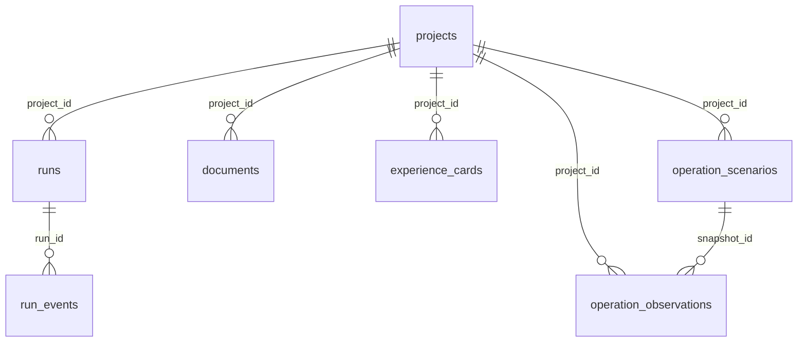

# 工作台数据库架构

工作台复用 `apps/host/store.ts` 的单个 `Store.db`。未配置外部数据库连接时使用 PGlite（嵌入式 PostgreSQL），配置后沿用同一个 `Database` 接口连接 PostgreSQL。业务记录位于 `public` schema，文档原件、地图缓存和 DSH 会话另存文件目录。

`public` 是数据库命名空间，不代表允许匿名访问。网页管理员是应用身份；管理员登录、数据库结构导出及现有运行库迁移，都不改变 PostgreSQL 的角色、对象 owner、GRANT 或数据库连接权限。

## 当前服务器读回

2026年10月15日，从运行中的宿主连接导出 **29张业务表、4个序列**，未发现未支持对象。现存数据包括16个项目、21份文档和28张经验卡。线上导出的schema-only SQL已在新的空PGlite中重建29张表；重建后的项目行数为0，确认结构导出没有混入业务数据。

管理员登录后可使用顶部“数据库结构”下载JSON，或访问 `/api/admin/database-schema?format=sql` 下载SQL。公开访客不能调用这两个管理导出。服务器保留一份权限受控的结构资料：

```text
/home/zhuhangcheng/apps/haizhizi/shared/database-schema/
  schema.json
  schema.sql
  工作台数据库架构.md
```

SQL的SHA-256为 `ef32f52c33e6711aa9be99dbce38a495f6a20f78e244ef462f31a1c84d82fa33`。业务数据库位于下面的持久化目录，SQL文件本身不是第二份运行库。

## 业务表与源码 DDL

| 分组 | 表 | 结构定义位置 |
|---|---|---|
| 项目、运行、材料与工件 | `projects`、`runs`、`run_events`、`artifacts`、`documents`、`followups` | `packages/contracts/migrations/001_initial.sql`，由 `Store.open()` 初始化 |
| 经验卡及审核历史 | `experience_cards`、`experience_history` | `packages/experience/repository.ts` |
| 知识政策、技能及版本 | `knowledge_policies`、`knowledge_policy_history`、`knowledge_skills`、`knowledge_skill_history` | `packages/experience/knowledge-repository.ts` |
| 公开资讯与采集记录 | `intel_channels`、`intel_documents`、`intel_versions`、`intel_revision_log`、`intel_analysis_history`、`intel_observations`、`intel_analyses`、`intel_memberships`、`intel_jobs`、`intel_receipts`、`intel_reviews` | `packages/intelligence/repository.ts` |
| 社区运营预测与实际台账对照 | `operation_scenarios`、`operation_observations` | `packages/operations/service.ts` |
| 历史工程造价来源与条目 | `cost_library_sources`、`cost_library_items` | `packages/construction-costs/library.ts` |
| 更新模式与策略快照 | `renewal_mode_assessments`、`renewal_strategy_assessments` | `apps/host/renewal-mode.ts` |

各业务模块在 `apps/host/server.ts` 注册时初始化同一数据库。项目记录通过 `project_id` 关联材料、运行与经验卡；运行记录关联事件和工件。经验与知识以当前记录及历史版本表保存。造价和资讯保留来源与版本的复合键。大块业务内容使用 JSONB；全文检索使用已有 TSVECTOR / GIN 索引，部分索引约束同一项目的活动运行和活动资讯任务。

下图采用线上实际外键关系，展示主要记录如何衔接：



## 服务器持久化目录

根目录为 `/home/zhuhangcheng/apps/haizhizi/shared/data`，独立于每次部署的代码版本。

| 位置 | 内容 |
|---|---|
| `postgres/` | 现有 PGlite 运行库文件，由宿主持有；结构检查复用宿主连接 |
| `blobs/<project_id>/` | 项目上传原件，数据库 `documents.blob_name` 与内容 SHA 对应原件 |
| `map-screening/` | 已保存的地图初筛与研究缓存 |
| `sessions/<run_id>/` | DSH JSONL 会话记录 |

数据库行、原件与运行文件需要分别核对。已有运行库通过 PGlite 的 `dumpDataDir` 恢复时包含数据；本次 schema-only SQL 仅用于重建结构，不包含项目记录、原件、序列当前值或会话文件。完整备份继续按 [服务器部署说明](服务器部署说明.md) 停止写入后操作。

## 有界结构导出

`apps/host/database-schema.ts` 提供：

```ts
describeWorkbenchDatabase(db: Database): Promise<WorkbenchDatabaseSchema>
```

函数只读取现有连接的固定 `public` catalog，不接收 SQL、表名或目录参数。表行数仅对 catalog 已确认的表执行带正确标识符引用的 `count(*)`。返回字段为 `generated_at`、`schema`、`tables`、`sequences`、`issues`、`sql`；每张表包含列类型、默认值、非空约束、行数、约束和索引定义，序列包含起始值、增量、范围、缓存和归属。

SQL 顺序为序列、全部表、非外键约束、外键、非约束索引及序列归属。约束和索引定义分别来自 `pg_get_constraintdef`、`pg_get_indexdef`，保留主键、外键、唯一、CHECK、表达式索引、部分索引和 GIN 的实际定义。导出不包含行数据、连接串、密码、角色、owner 变更或权限授予。

视图、函数、触发器、枚举等未支持对象会出现在 `issues` 中，并在 SQL 开头标明不完整。导出对象包含这些缺口时，需要先处理列出的依赖，不能将 SQL 当作完整恢复包。

定点验证命令：

```powershell
npx vitest run tests/contracts/database-schema.test.ts
```

测试在两个独立内存 PGlite 间往返导入，核对 quoted identifiers、serial 序列与归属、JSONB、默认值、约束及索引，并检查测试行内容未出现在导出中；另对现有初始迁移 SQL 往返核对。线上访问、认证权限和服务器实际导出另由部署验收记录确认。
